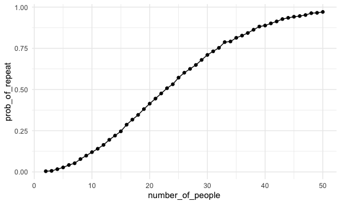
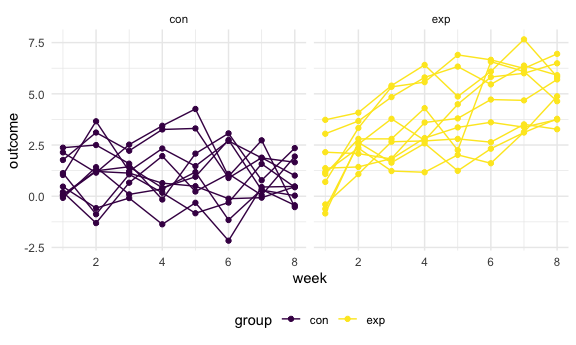
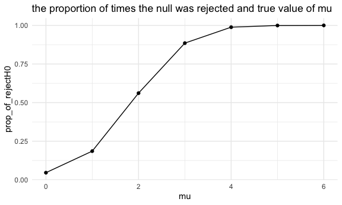
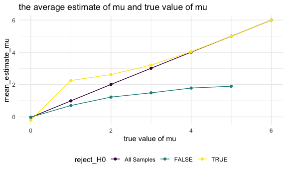

p8105_hw5_dt2833
================
Dominique Tzou
2026-11-17

``` r
library(tidyverse)
source("source/birthday_repeated.R")

set.seed(1236)
```

## Problem 01 Birthday Problem

Birthday function

``` r
birthday_results_df =
  expand_grid(
    number_of_people = 2:50,
    iter = 1:10000
  ) |> 
  mutate(
    repeated = map_lgl(number_of_people, birthday_repeated)
  )
```

Plotting the probability as a function of group size

``` r
birthday_results_df |> 
  group_by(number_of_people) |> 
  summarize(prob_of_repeat = mean(repeated)) |> 
  ggplot(aes(x = number_of_people, y = prob_of_repeat)) + 
  geom_point() + 
  geom_line()
```



At around 23 people, there is at least a 50% chance that at least two
people have the same birthday. At 50 people, it is at least 90% chance.

## Problem 02

Create a tidy dataframe containing data from all participants, including
the subject ID, arm, and observations over time:

Start with a dataframe containing all file names; the list.files
function will help Iterate over file names and read in data for each
subject using purrr::map and saving the result as a new variable in the
dataframe Tidy the result; manipulate file names to include control arm
and subject ID, make sure weekly observations are “tidy”, and do any
other tidying that’s necessary Make a spaghetti plot showing
observations on each subject over time, and comment on differences
between groups.

Creating dataset

``` r
full_df = 
  tibble(
    files = list.files("data/"),
    path = str_c("data/", files)
  ) |>
  mutate(data = map(path, read_csv)) |>
  unnest()
```

    ## Rows: 1 Columns: 8
    ## ── Column specification ────────────────────────────────────────────────────────
    ## Delimiter: ","
    ## dbl (8): week_1, week_2, week_3, week_4, week_5, week_6, week_7, week_8
    ## 
    ## ℹ Use `spec()` to retrieve the full column specification for this data.
    ## ℹ Specify the column types or set `show_col_types = FALSE` to quiet this message.
    ## Rows: 1 Columns: 8
    ## ── Column specification ────────────────────────────────────────────────────────
    ## Delimiter: ","
    ## dbl (8): week_1, week_2, week_3, week_4, week_5, week_6, week_7, week_8
    ## 
    ## ℹ Use `spec()` to retrieve the full column specification for this data.
    ## ℹ Specify the column types or set `show_col_types = FALSE` to quiet this message.
    ## Rows: 1 Columns: 8
    ## ── Column specification ────────────────────────────────────────────────────────
    ## Delimiter: ","
    ## dbl (8): week_1, week_2, week_3, week_4, week_5, week_6, week_7, week_8
    ## 
    ## ℹ Use `spec()` to retrieve the full column specification for this data.
    ## ℹ Specify the column types or set `show_col_types = FALSE` to quiet this message.
    ## Rows: 1 Columns: 8
    ## ── Column specification ────────────────────────────────────────────────────────
    ## Delimiter: ","
    ## dbl (8): week_1, week_2, week_3, week_4, week_5, week_6, week_7, week_8
    ## 
    ## ℹ Use `spec()` to retrieve the full column specification for this data.
    ## ℹ Specify the column types or set `show_col_types = FALSE` to quiet this message.
    ## Rows: 1 Columns: 8
    ## ── Column specification ────────────────────────────────────────────────────────
    ## Delimiter: ","
    ## dbl (8): week_1, week_2, week_3, week_4, week_5, week_6, week_7, week_8
    ## 
    ## ℹ Use `spec()` to retrieve the full column specification for this data.
    ## ℹ Specify the column types or set `show_col_types = FALSE` to quiet this message.
    ## Rows: 1 Columns: 8
    ## ── Column specification ────────────────────────────────────────────────────────
    ## Delimiter: ","
    ## dbl (8): week_1, week_2, week_3, week_4, week_5, week_6, week_7, week_8
    ## 
    ## ℹ Use `spec()` to retrieve the full column specification for this data.
    ## ℹ Specify the column types or set `show_col_types = FALSE` to quiet this message.
    ## Rows: 1 Columns: 8
    ## ── Column specification ────────────────────────────────────────────────────────
    ## Delimiter: ","
    ## dbl (8): week_1, week_2, week_3, week_4, week_5, week_6, week_7, week_8
    ## 
    ## ℹ Use `spec()` to retrieve the full column specification for this data.
    ## ℹ Specify the column types or set `show_col_types = FALSE` to quiet this message.
    ## Rows: 1 Columns: 8
    ## ── Column specification ────────────────────────────────────────────────────────
    ## Delimiter: ","
    ## dbl (8): week_1, week_2, week_3, week_4, week_5, week_6, week_7, week_8
    ## 
    ## ℹ Use `spec()` to retrieve the full column specification for this data.
    ## ℹ Specify the column types or set `show_col_types = FALSE` to quiet this message.
    ## Rows: 1 Columns: 8
    ## ── Column specification ────────────────────────────────────────────────────────
    ## Delimiter: ","
    ## dbl (8): week_1, week_2, week_3, week_4, week_5, week_6, week_7, week_8
    ## 
    ## ℹ Use `spec()` to retrieve the full column specification for this data.
    ## ℹ Specify the column types or set `show_col_types = FALSE` to quiet this message.
    ## Rows: 1 Columns: 8
    ## ── Column specification ────────────────────────────────────────────────────────
    ## Delimiter: ","
    ## dbl (8): week_1, week_2, week_3, week_4, week_5, week_6, week_7, week_8
    ## 
    ## ℹ Use `spec()` to retrieve the full column specification for this data.
    ## ℹ Specify the column types or set `show_col_types = FALSE` to quiet this message.
    ## Rows: 1 Columns: 8
    ## ── Column specification ────────────────────────────────────────────────────────
    ## Delimiter: ","
    ## dbl (8): week_1, week_2, week_3, week_4, week_5, week_6, week_7, week_8
    ## 
    ## ℹ Use `spec()` to retrieve the full column specification for this data.
    ## ℹ Specify the column types or set `show_col_types = FALSE` to quiet this message.
    ## Rows: 1 Columns: 8
    ## ── Column specification ────────────────────────────────────────────────────────
    ## Delimiter: ","
    ## dbl (8): week_1, week_2, week_3, week_4, week_5, week_6, week_7, week_8
    ## 
    ## ℹ Use `spec()` to retrieve the full column specification for this data.
    ## ℹ Specify the column types or set `show_col_types = FALSE` to quiet this message.
    ## Rows: 1 Columns: 8
    ## ── Column specification ────────────────────────────────────────────────────────
    ## Delimiter: ","
    ## dbl (8): week_1, week_2, week_3, week_4, week_5, week_6, week_7, week_8
    ## 
    ## ℹ Use `spec()` to retrieve the full column specification for this data.
    ## ℹ Specify the column types or set `show_col_types = FALSE` to quiet this message.
    ## Rows: 1 Columns: 8
    ## ── Column specification ────────────────────────────────────────────────────────
    ## Delimiter: ","
    ## dbl (8): week_1, week_2, week_3, week_4, week_5, week_6, week_7, week_8
    ## 
    ## ℹ Use `spec()` to retrieve the full column specification for this data.
    ## ℹ Specify the column types or set `show_col_types = FALSE` to quiet this message.
    ## Rows: 1 Columns: 8
    ## ── Column specification ────────────────────────────────────────────────────────
    ## Delimiter: ","
    ## dbl (8): week_1, week_2, week_3, week_4, week_5, week_6, week_7, week_8
    ## 
    ## ℹ Use `spec()` to retrieve the full column specification for this data.
    ## ℹ Specify the column types or set `show_col_types = FALSE` to quiet this message.
    ## Rows: 1 Columns: 8
    ## ── Column specification ────────────────────────────────────────────────────────
    ## Delimiter: ","
    ## dbl (8): week_1, week_2, week_3, week_4, week_5, week_6, week_7, week_8
    ## 
    ## ℹ Use `spec()` to retrieve the full column specification for this data.
    ## ℹ Specify the column types or set `show_col_types = FALSE` to quiet this message.
    ## Rows: 1 Columns: 8
    ## ── Column specification ────────────────────────────────────────────────────────
    ## Delimiter: ","
    ## dbl (8): week_1, week_2, week_3, week_4, week_5, week_6, week_7, week_8
    ## 
    ## ℹ Use `spec()` to retrieve the full column specification for this data.
    ## ℹ Specify the column types or set `show_col_types = FALSE` to quiet this message.
    ## Rows: 1 Columns: 8
    ## ── Column specification ────────────────────────────────────────────────────────
    ## Delimiter: ","
    ## dbl (8): week_1, week_2, week_3, week_4, week_5, week_6, week_7, week_8
    ## 
    ## ℹ Use `spec()` to retrieve the full column specification for this data.
    ## ℹ Specify the column types or set `show_col_types = FALSE` to quiet this message.
    ## Rows: 1 Columns: 8
    ## ── Column specification ────────────────────────────────────────────────────────
    ## Delimiter: ","
    ## dbl (8): week_1, week_2, week_3, week_4, week_5, week_6, week_7, week_8
    ## 
    ## ℹ Use `spec()` to retrieve the full column specification for this data.
    ## ℹ Specify the column types or set `show_col_types = FALSE` to quiet this message.
    ## Rows: 1 Columns: 8
    ## ── Column specification ────────────────────────────────────────────────────────
    ## Delimiter: ","
    ## dbl (8): week_1, week_2, week_3, week_4, week_5, week_6, week_7, week_8
    ## 
    ## ℹ Use `spec()` to retrieve the full column specification for this data.
    ## ℹ Specify the column types or set `show_col_types = FALSE` to quiet this message.

    ## Warning: `cols` is now required when using `unnest()`.
    ## ℹ Please use `cols = c(data)`.

Cleaning

``` r
tidy_df = 
  full_df |> 
  mutate(
    files = str_replace(files, ".csv", ""),
    subject_id = str_sub(files, 5, 6),
    group = str_sub(files, 1, 3)) |>
  pivot_longer(
    week_1:week_8,
    names_to = "week",
    values_to = "outcome",
    names_prefix = "week_") %>% 
  mutate(week = as.numeric(week)) %>% 
  select(group, grp_sid = files,  subject_id, week, outcome)
```

spaghetti plot of subjects in each arm

``` r
tidy_df |>  
  ggplot(aes(x = week, y = outcome, group = subject_id, color = group)) + 
  geom_point() + 
  geom_path() + 
  facet_grid(~group)
```



For subjects among the control arm, outcome remains within a relatively
similar range across time. There is no significant overall increase or
decrease in outcome over time.

For subjects among the experiental arm, outcome overall increases over
time. Comparing starting and ending outcome of subjects, overall outcome
increases by the end of the study.

## Problem 03

``` r
source("source/t_test.R")
#simulation dataset and ttest results
sim_results_df = 
  expand_grid(
    mu = 0:6, 
    iter = 1:5000
  ) |> 
  mutate(
    est_df = map(mu, t_test)
  ) |> 
  unnest(est_df)
```

### Plots

**The proportion of times the null was rejected and true value of mu**

``` r
#the proportion of times the null was rejected and true value of mu
sim_results_df |> 
group_by(mu) |> 
 summarize(prop_of_rejectH0 = mean(reject_H0)) |> 
  ggplot(aes(x = mu, y = prop_of_rejectH0)) + 
  geom_point() + 
  geom_line()+
   labs( title = "the proportion of times the null was rejected and true value of mu")
```


As effect size increases ( greater mu) and power increases as well.

**the average estimate of mu and true value of mu**

``` r
#dataset of the average estimate of 𝜇 for all samples
mean_estimate_df = 
sim_results_df |> 
 group_by(mu) |> 
  summarize(mean_estimate_mu = mean(estimate)) 

#dataset of the average estimate of 𝜇 for only in samples for which the null was rejected
reject_H0_df = 
sim_results_df |> 
  filter(reject_H0 == TRUE )|>
 group_by(mu,reject_H0) |> 
  summarize(mean_estimate_mu = mean(estimate)) 
```

    ## `summarise()` has regrouped the output.
    ## ℹ Summaries were computed grouped by mu and reject_H0.
    ## ℹ Output is grouped by mu.
    ## ℹ Use `summarise(.groups = "drop_last")` to silence this message.
    ## ℹ Use `summarise(.by = c(mu, reject_H0))` for per-operation grouping
    ##   (`?dplyr::dplyr_by`) instead.

``` r
failreject_H0_df = 
sim_results_df |> 
  filter(reject_H0 == FALSE )|>
 group_by(mu,reject_H0) |> 
  summarize(mean_estimate_mu = mean(estimate)) 
```

    ## `summarise()` has regrouped the output.
    ## ℹ Summaries were computed grouped by mu and reject_H0.
    ## ℹ Output is grouped by mu.
    ## ℹ Use `summarise(.groups = "drop_last")` to silence this message.
    ## ℹ Use `summarise(.by = c(mu, reject_H0))` for per-operation grouping
    ##   (`?dplyr::dplyr_by`) instead.

``` r
#plot
ggplot() + 
  geom_point(data = mean_estimate_df, aes(x = mu, y = mean_estimate_mu, color= "All Samples"))+
  geom_line(data = mean_estimate_df, aes(x = mu, y = mean_estimate_mu, color= "All Samples")) +
  geom_point(data = reject_H0_df, aes(x = mu, y = mean_estimate_mu,color= reject_H0)) + 
  geom_line(data = reject_H0_df, aes(x = mu, y = mean_estimate_mu,color= reject_H0)) + 
  geom_point(data = failreject_H0_df, aes(x = mu, y = mean_estimate_mu,color= reject_H0)) + 
  geom_line(data = failreject_H0_df, aes(x = mu, y = mean_estimate_mu,color= reject_H0))+
  labs( title = "the average estimate of mu and true value of mu", 
        x = "true value of mu ")
```



``` r
sim_results_df |> 
  filter(reject_H0 == TRUE )|> 
  count(mu)
```

    ## # A tibble: 7 × 2
    ##      mu     n
    ##   <int> <int>
    ## 1     0   231
    ## 2     1   929
    ## 3     2  2807
    ## 4     3  4426
    ## 5     4  4942
    ## 6     5  4996
    ## 7     6  5000

The sample average of 𝜇̂ across tests for which the null is rejected is
not approximately equal to the true value of 𝜇, for all 𝜇.

With less effect size (smaller true values of mu) and less power, mean
estimates of mu are further away from (greater than) the true value, and
a true effect is less easily identified ( more extreme values are needed
to reject H0)

As mu increases and effect size increases and thus power increases, a
true effect is more easily identified and mean estimates of mu are close
to the true mu. A greater proportion samples are being rejected.
